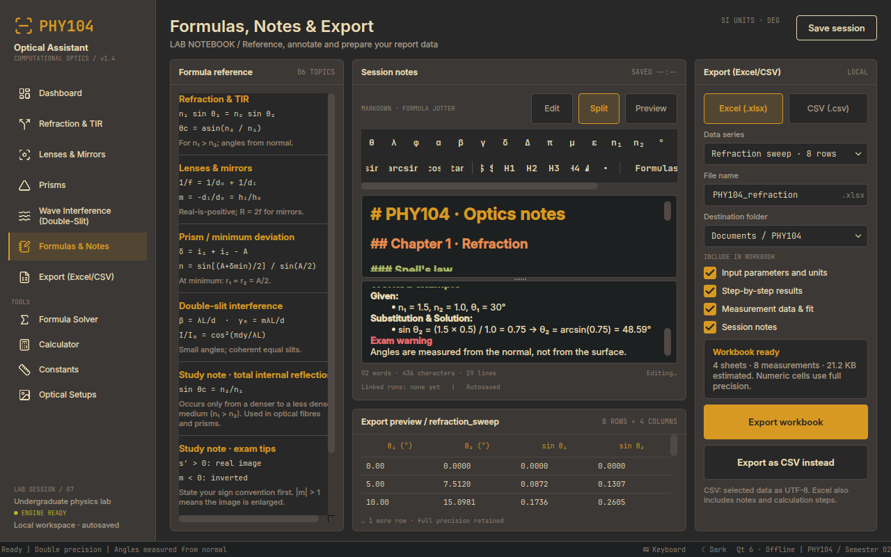

# PHY104 Optical Assistant

[](https://github.com/movdy2/phy104-sim/actions/workflows/build.yml)

Desktop application (C++20, Qt 6 Widgets, CMake, JSON data) for PHY104 - Optics and Wave Optics.
Windows and Linux. No database, no network. The UI follows the Figma design `optics_lab.phy`
(see [docs/FIGMA_MAPPING.md](docs/FIGMA_MAPPING.md)).

| | |
|---|---|
|  |  |
|  |  |
|  |  |

## Study workspace (Notes)
Markdown editor with live preview (Edit / Split / Preview) and Gruvbox colour coding: `#` yellow 18 pt, `##` orange 14 pt,
`###` green 12 pt, `####` red 11 pt (exam warning), formulas (`$...$`, `$$...$$`, `` `code` ``, bracketed maths) aqua in JetBrains Mono,
bullets light grey. Snippet toolbar (θ λ φ δ Δ n₁ n₂ sin arcsin ... and a formulas menu) and a **Problem template**
(`### Given:` / `### Formula:` / `### Substitution & Solution:`). In the preview every formula is drawn as a LaTeX image
by `LatexRenderer`; Qt's Markdown importer drops images with an empty alt text, so each formula image carries an alt text
(``) and an image written as `` is given one before import. Notes autosave ~0.7 s after typing
into the session, into every snapshot's `notesContent`, and into the `.phy` file.

## Screens

| Sidebar item | What it does |
|---|---|
| **Dashboard** | 11-experiment count, four featured cards and a **Browse all 11** menu, recent calculations (**Recent / Compare**: overlay two saved runs, delete a run), lab notebook |
| **Refraction & TIR** | Snell's law and total internal reflection: two incidence cases, regression chart, LCD registers |
| **Lenses & Mirrors** | thin lens and spherical mirror (same equations), principal rays, image properties |
| **Prisms** | ray path, minimum deviation, deviation curve, dispersion mode (red / λ / violet rays) |
| **Wave Interference** | Young's double slit: wavefronts, fringes, intensity profile, 6 light-source presets |
| **Polarization**, **Single slit**, **Grating**, **Thin film**, **Michelson**, **Newton's rings** | the six screens of the second Figma batch (Save + export icon, Send to Notes); **every tab of every screen works** (thin-film transmission **and its colour swatch**, Michelson fringe count, grating orders **and resolving power**, slit geometry **and the two-slit envelope**, Malus/Brewster) and Newton's viewing-mode dropdown switches to the transmitted rings |
| **Thick Lens & Aberration** | a real glass element: signed `R₁ R₂`, centre thickness, aperture → paraxial power, **principal planes**, BFL/FFL, imaging from `H₂`, **third-order spherical aberration** (`ΔSA ∝ D²`) and a **Spectrum** tab with the Cauchy focal spread and Abbe number |
| **Notes** | the clean Markdown study workspace of the design: editor + snippet toolbar + live LaTeX preview, autosaved; **⌨ Keyboard** opens the scientific keyboard (from `keyboard.json`) and types LaTeX straight into the note |
| **Page actions** | every main-page header uses the same **Save** button plus one **Export** menu for PDF report / Excel (.xlsx) / CSV (.csv); all formats open the unified Export destination |
| *Tools:* **Export** | one sidebar destination with **Series data** (full CSV/Excel tables, workbook settings and Print…) and **PDF report** (academic lab-report layout, session metadata, numbered experiments, figure captions, page-numbered PDF and Print…); recent exports are remembered in the `.phy` session |
| *Tools:* **Formula Solver** | 42 formulas in 7 chapters: search, chapter filter, paging, LaTeX, LCD input/answer |
| *Tools:* **Calculator** | clean expression → result layout with recent history, DEG/RAD, `Ans`, and a focused math keypad (numbers, operators, parentheses, powers, roots, trig and logs); no extra physics-variable browser |
| *Tools:* **Study Hub** | tabs for ten chapters (summary, rules and chapter constants), shared autosaving Notes, and six Optical Setups (PNG export); the Notes shortcut stays in the sidebar, and global Constants are no longer a Study Hub tab |

Common to the experiment pages: live update while typing, **Calculate & Simulate** saves a run to the session,
**Reset parameters**, invalid input never shows `NaN` - a red field, an `E_...` register with the
**last valid result retained**, and an explanation card. Session (`optics_lab.phy`) autosaves and is restored on start.
Light and dark theme (status bar), virtual keyboard (status bar).

## Build

```
cmake -S . -B build -DCMAKE_BUILD_TYPE=Release
cmake --build build
ctest --test-dir build              # core + real-data round trips + UI/LaTeX/SVG/fonts/colours
./build/src/PHY104OpticalAssistant  # data/ is copied next to the executable
```

Needs Qt 6 **Widgets and Svg** (Ubuntu: `qt6-base-dev qt6-svg-dev`). Fonts (Inter, JetBrains Mono) and icons
(Lucide) are bundled in `assets/` - nothing to install. Windows: add `-DCMAKE_PREFIX_PATH=C:/Qt/6.x.x/msvc2019_64`.
Core only (no Qt): `-DPHY104_BUILD_GUI=OFF`.
CI (`.github/workflows/build.yml`) builds Linux (Qt 6 + ctest), Windows (MSVC + Qt 6.8.3) and a Qt-free `g++` core
test on pull requests and configured branch pushes; the Linux job also publishes UI screenshots as an artifact. A manual run can optionally commit the refreshed screenshot set to the selected branch.

### Keyboard shortcuts

| keys | what it does |
|---|---|
| `Ctrl+S` | save the session (`.phy`) |
| `Ctrl+Enter` | the main action of the page that is showing: **Calculate & Simulate** on the experiment screens, **Solve** on the Formula Solver |
| `Ctrl+P` | open the **PDF report** mode on Export (preview, Save PDF, Print…) |
| `Ctrl+1` … `Ctrl+9` | the first nine pages of the sidebar |
| `Ctrl+Tab` | next page |
| `F11` | full screen (the window starts maximised) |

Developer option: `PHY104OpticalAssistant --screenshots <folder>` drives the UI (saves runs, exports a workbook,
triggers error states) and writes a PNG of every page in both themes.

## Layers

```
Presentation  src/ui            Qt Widgets: pages, components, canvases, charts, LaTeX renderer, theme
Business      src/core          pure C++ (no Qt): physics, ExperimentReports, SolverEngine, FormulaManager,
                                MathCalculator, SessionLog, DataExport + XlsxWriter, ExpressionEvaluator ...
Data          src/data + data/  JSON repositories (formulas, variables, constants, chapters, keyboard,
                                optics presets, formula reference) and the .phy session file
Assets        assets/           fonts, Lucide icons, SVG diagrams (generated by tools/make_diagrams.py)
```

`src/core` never includes Qt and reaches files only through the interfaces in `Repositories.h`.
The pages contain **no physics and no number formatting**: `ExperimentReports` returns the LCD registers,
notices and chart data as plain structs and the page only displays them.

## Data files (`data/`)

`formulas.json` (42 formulas, equation text + LaTeX + chapter) · `chapters.json` · `variables.json` ·
`constant.json` · `keyboard.json` · `optics_presets.json` (media with Cauchy dispersion, light sources) ·
`reference.json` (formula reference topics and the unit-discipline note).

### Add a formula (no C++)
1. Add `{ "id", "name", "equation", "latex", "chapter" }` to `formulas.json` (`chapter` = id from `chapters.json`).
2. Every variable must exist in `variables.json` (the app and `ctest` warn otherwise).
3. Optional `"units"` override and `"noSolutionHint"`. Run `ctest`: it solves the formula for every variable.

### Add a medium or light source
Edit `optics_presets.json`; it appears in the dropdowns. `cauchyA + cauchyB/λ²` (λ in µm) must give `n` at 589.3 nm
(a test checks this).

## Units
Units are shown alongside their fields; angles default to degrees, with a DEG/RAD toggle in the calculator. Formula Solver fields accept `550*nm`, `0.5*mm`, `π`, `√(16)`, `c`, `ε₀`.
Fonts: Inter and JetBrains Mono (SIL OFL), icons: Lucide (ISC) - see `assets/fonts/LICENSES.txt`.
